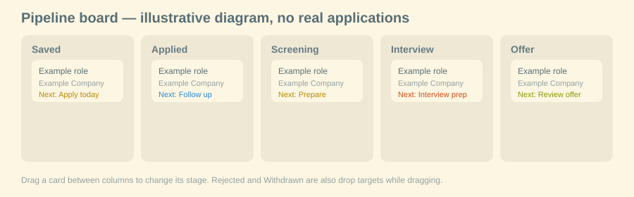
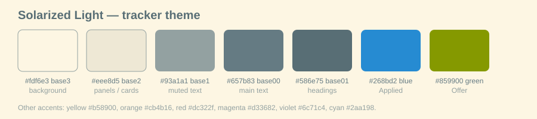

# Job Application Tracker

A pipeline board for tracking job applications, with a Solarized Light theme,
consistent-size cards, and a resume workspace for each application.

**No application data is included in this repository.** No real companies,
roles, applications, resumes, documents, or personal details are in the code,
in the images, or in any seed data. The app starts empty — add your own jobs
after setup.





> The images above are diagrams, not screenshots of a real account. They use
> generic "Example role" / "Example Company" placeholders only.

## What it does

- **Pipeline board** — Saved → Applied → Screening → Interview → Offer,
  plus Rejected and Withdrawn. Drag a card between columns to change its
  stage; dropping a job into Applied stamps its applied date the first time.
- **Pipeline flow** — a snapshot diagram at the top of the Pipeline tab
  showing all applications flowing into their current stages. It recomputes
  live from the board; it is not a history of every stage a job passed through.
- **Consistent cards** — fixed rows, titles clamped to two lines, and a
  single short next-step line, so cards stay the same size.
- **Next steps** — short, simple labels such as `Apply today` and
  `Send follow-up to recruiter`, with one-tap chips for those steps in the
  job editor. The full next-step text is still available in the editor and
  on hover.
- **Application details** — company, title, location, work type, salary,
  job link, deadline, job description, notes, and next step. Dropdowns in
  the details editor are sized the same as the text boxes beside them.
  There is no dropdown on the pipeline cards themselves.
- **Coming up** — a deadline list for applications with a deadline set.
- **Saved searches** — save a search, see how many tracked jobs it matches,
  and re-run it.
- **Resumes** — base and tailored resume versions as text, an AI tailor
  that only reworks existing resume content, and a resume-vs-job-description
  match check with a percentage score, matched vs. missing keywords,
  strengths, gaps, and edit suggestions. Past checks are kept.
- **Files** — uploads (up to 15 MB in the hosted version) that can be
  attached to an application or kept in a library, with PDF/image preview.
- **Theme** — Solarized Light throughout: `#fdf6e3` background,
  `#eee8d5` panels and cards, `#657b83` text, `#586e75` headings,
  `#93a1a1` muted text, and Solarized accents.

## How to use it

1. Add a job with **Add a job**, or open an existing card to edit it.
2. Fill in company, title, location, work type, salary, link, deadline,
   and the full job description if you want a resume match check.
3. Move the card by dragging it to another stage column, or change its
   stage in the application details editor.
4. Set a short next step, for example `Apply today` or
   `Send follow-up to recruiter`.
5. In Resumes, save a base resume, create a tailored version for a job,
   and run the match check to see what to improve.
6. Attach files to a job, or keep them in the Files library.

## Setup

### Important: this source was built for a hosted runtime

This codebase was built as a Muse hosted TypeScript web artifact. Its
client and server import `@hatch/space-sdk` (see `package.json`, where it
is a `file:` dependency pointing at the hosted runtime), and its data layer
is Drizzle over SQLite in that hosted runtime (`drizzle/`, `server/src/`).

That means this repository is **not a drop-in, standalone local app
out of the box**. If you clone it and run `bun install`, the hosted
space-sdk dependency will not resolve outside that runtime. Do not expect
`bun run build` to produce a working standalone app without adapting the
action/client layer first.

### What you need

- [Bun](https://bun.sh) 1.3.x (the project pins `bun@1.3.10` in
  `package.json`)
- TypeScript, via Bun

### Hosted / Muse setup (the version this code came from)

1. Clone the repository.
2. Open it as a Muse TypeScript web artifact / space, with the hosted
   runtime providing `@hatch/space-sdk`.
3. The app starts empty. Add jobs, resumes, and files from the UI.

### Local adaptation (guide, not verified out of the box)

To run a standalone version locally, you would need to:

1. Replace the `@hatch/space-sdk` imports in `client/src/api.ts`,
   `client/src/main.tsx`, `client/src/App.tsx`, and the editor/file
   components with your own API client.
2. Replace the server actions in `server/src/actions.ts` with an HTTP
   API (for example, a small Bun server) that implements the same
   operations: list/create/update/delete applications, resumes, saved
   searches, documents, and match analyses.
3. Point Drizzle at a local SQLite database and apply the migrations in
   `drizzle/` in order (`0001_initial.sql`, `0002_tracker_tables.sql`,
   `0003_add_job_description_and_match_analysis.sql`).
4. Build the client with `client/build.mjs` and serve `client/dist/`
   alongside your API.

### Commands in `package.json`

```sh
bun install
bun run typecheck
bun run build
bun run build:server
bun run build:client
```

`typecheck` checks the client and server TypeScript configs.
`build` builds the server actions and then the client. These commands
assume the hosted space-sdk is available, as noted above.

## Project layout

```text
client/
  index.html
  build.mjs
  tsconfig.json
  src/
    App.tsx
    main.tsx
    api.ts
    shared.ts
    theme.css
    components/
      Board.tsx
      PipelineFlow.tsx
      ApplicationEditor.tsx
      ResumesView.tsx
      SearchesView.tsx
      FilesView.tsx
      FilePreview.tsx
      MatchAnalysisCard.tsx
server/
  tsconfig.json
  src/
    actions.ts
    schema.ts
drizzle/
  0001_initial.sql
  0002_tracker_tables.sql
  0003_add_job_description_and_match_analysis.sql
docs/
  images/
    pipeline-board.svg
    solarized-palette.svg
```

## Privacy

- This repository contains **code only**. It contains no database file,
  no uploaded documents, no resumes, and no application records.
- Do not commit a real database, uploaded files, or exported tracker data
  to this repository. The `.gitignore` excludes databases, uploads, build
  output, and dependencies for that reason.

## License

No license is set in this repository yet. Add one before sharing it
publicly if you want others to be able to reuse the code.
